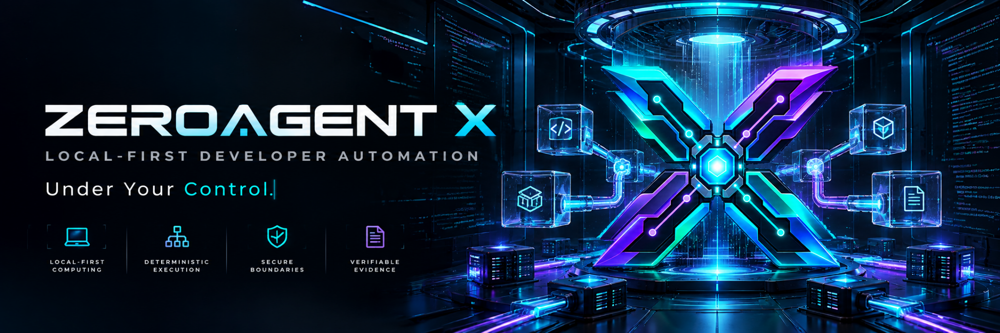
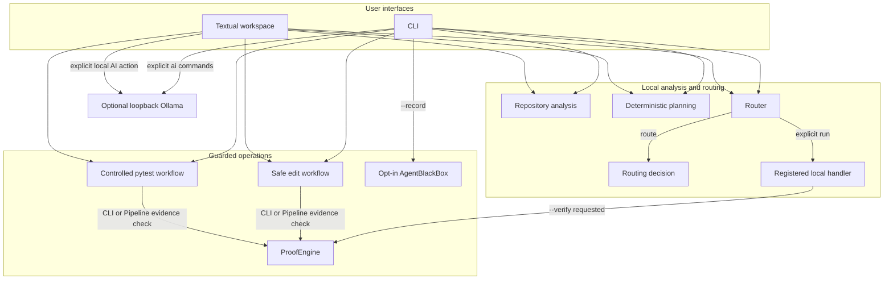

<p align="center">
  
</p>

<p align="center"><strong>Local-First Developer Automation, Under Your Control.</strong></p>

<p align="center">
  Deterministic routing · controlled local workflows · structural evidence verification · interactive terminal workspace
</p>

<p align="center">
  <a href="https://github.com/harisazharir-boop/zeroagent-x/actions/workflows/ci.yml"></a>
  
  
  
  <a href="LICENSE"></a>
</p>

<p align="center">
  <a href="#overview">Overview</a> · <a href="#features">Features</a> · <a href="#architecture">Architecture</a> · <a href="#quick-start">Quick Start</a> · <a href="#cli">CLI</a> · <a href="#textual-workspace">TUI</a><br>
  <a href="#security-by-design">Security</a> · <a href="#platform-support">Platform Support</a> · <a href="#documentation">Documentation</a> · <a href="#contributing">Contributing</a>
</p>

> **Unpublished beta candidate.** ZEROAGENT X `0.12.0b1` is prepared for release review, not published. It does not promise semantic code correctness, complete security, or unrestricted autonomous coding.

## Overview

ZEROAGENT X is an open-source local-first developer workflow tool. It provides read-only repository analysis and planning, registered local capability routing, approval-bound edits and tests, ProofEngine structural checks, opt-in local history, and a Textual terminal workspace.

### Why ZEROAGENT X?

- **Local-first.** Default settings disable telemetry, cloud providers, paid APIs, network access, and shell-command execution. Optional Ollama use is explicit and loopback-only.
- **Deterministic.** Routing selects from registered local capabilities using fixed rules and policy decisions. It is not general autonomous execution.
- **Controlled.** Sensitive operations require explicit actions and approval-bound exact digests.
- **Verifiable.** ProofEngine reports `VERIFIED`, `FAILED`, or `INCOMPLETE` for implemented structural checks; it does not establish semantic correctness.
- **Transparent.** AgentBlackBox recording is explicit opt-in; replay displays stored history without rerunning work. Redaction is best effort.

No paid API is required by built-in capabilities. Local CPU, storage, hardware, and electricity still have costs.

## Features

### External agent execution

`zeroagent agent` exposes registered external adapters, request validation, explicit
request-bound approval, execution, and sanitized local evidence. Agent execution,
OpenCode, and network access remain disabled by default. Start with:

```bash
zeroagent agent adapters
zeroagent agent validate "Summarize this workspace" --workspace . --record
zeroagent agent approve "Summarize this workspace" --workspace . --record
zeroagent agent run "Summarize this workspace" --workspace . --record \
  --approval-token <single-use-token-from-agent-approve>
```

`zeroagent tui` includes **External Agent Control Center** inside Agent Workspace.
Preview shows adapter, workspace, bounded task, network requirement, timeout policy,
and request fingerprint. Fingerprint is not credential; explicit Start makes local
single-use authorization. Cancel targets only current
in-process coordinator request. CLI cross-process cancellation is not advertised;
use `Ctrl+C` in owning `agent run` process. Evidence is sanitized, bounded local
history, not tamper-proof proof. External agents are not sandboxed and interrupted
operations may have changed workspace files.

|  |  |
|:---|:---|
| **◇ Deterministic Routing**<br><sub>Fixed task classification and static local capabilities. `route` decides; `run` separately invokes only permitted registered handlers.</sub> | **◆ ProofEngine**<br><sub>Checks routing and artifact structure with explicit status. It does not prove source safety or semantic correctness.</sub> |
| **▣ Safe Code Editing**<br><sub>Text-only structured proposals require exact approval, containment checks, and byte-exact SHA-256 stale checks. Multi-file apply is not atomic.</sub> | **◉ AgentBlackBox**<br><sub>Opt-in sanitized local history with bounded retention and read-only replay. Redaction is best effort; storage is not tamper-proof.</sub> |
| **▤ Textual Agent Workspace**<br><sub>Active CLI-launched full-screen Textual UI for planning, inspection, explicit actions, and status. Interactive terminal required.</sub> | **▧ Guarded Pipeline**<br><sub>Starts `OFF`; plan and analysis pause for review. Edit and test remain separate, approval-bound, owned operations.</sub> |

## Architecture



Not every operation uses the router, ProofEngine, or BlackBox. TUI uses same local services but has its own explicit UI actions. Ollama is optional, installed and started manually, and never used as cloud fallback. See [architecture](docs/architecture.md).

## Quick Start

Requires Python 3.11 or newer. CI validates Python 3.11, 3.12, and 3.13.

**Ubuntu / Linux**

```bash
python -m venv .venv
.venv/bin/python -m pip install -e ".[dev]"
.venv/bin/zeroagent doctor
.venv/bin/zeroagent --help
```

Successful `zeroagent doctor` reports local runtime details and current safe-default policy state. It does not contact cloud providers or execute repository code.

**Windows PowerShell**

```powershell
python -m venv .venv
.venv\Scripts\python.exe -m pip install -e ".[dev]"
.venv\Scripts\zeroagent.exe doctor
.venv\Scripts\zeroagent.exe --help
```

Use `python -m zeroagent --help` if console-script lookup fails. Project is not published to PyPI; commands above require source checkout. Full paths, activation, and tested-install scope: [installation guide](docs/installation.md).

## CLI

```bash
# Read-only repository report
zeroagent analyze . --format json

# Deterministic decision only: never invokes handler
zeroagent route "Analyze this repository"

# Explicit policy-permitted registered local handler
zeroagent run "Analyze this repository" --workspace .

# Explicit execution plus structural evidence checks
zeroagent run "Analyze this repository" --workspace . --verify

# Optional local Ollama diagnostics
zeroagent ai doctor

# Planning never executes tools
zeroagent plan create "Explain this project" --workspace .
```

`analyze --output PATH` creates a new JSON file and rejects an existing destination. `route` only returns decision evidence. `run` executes a permitted registered handler. `run --verify` adds structural verification. Full command, side-effect, and exit-code reference: [usage guide](docs/usage.md).

## Textual Workspace

**Interactive terminal required.** Bare `zeroagent` opens active full-screen Textual workspace. Use `zeroagent tui --workspace .` to select workspace explicitly. Noninteractive bare invocation prints CLI help; `zeroagent tui` rejects noninteractive use.

| Explore | Control |
|:---|:---|
| **Agent Workspace** separates Route → Run → Verify for supported tasks. Repository analysis, context research, planning, ProofEngine, history, replay, settings, and help remain available as focused screens. | **Safe Editing**, **Controlled Tests**, and **Pipeline** make approval and execution separate actions. Pipeline begins `OFF`; cancellation waits for owned work to settle. |

Local AI remains optional and model output is untrusted.

Safe edits require current exact-digest approval, reject stale source bytes, and may leave partial multi-file changes on failure. Recovery is explicit, outside workspace, and best effort. See [Textual workspace guide](docs/tui.md).

## Security by Design

- Offline-first safe defaults; no cloud or paid-provider fallback.
- Static capabilities and policy checks; unknown tasks do not execute.
- Explicit workspace selection and containment checks.
- Approval-bound safe editing and controlled `pytest` execution.
- Byte-exact SHA-256 proposal validation and stale-proposal rejection.
- Portable relative-path evidence validation in ProofEngine.
- Opt-in local BlackBox records; bounded storage and best-effort redaction.

Limits matter: ProofEngine is structural, not semantic; BlackBox storage is not tamper-proof; controlled tests execute workspace code without OS sandboxing; multi-file edit application is not transactional. Full threat model and reporting route: [SECURITY.md](SECURITY.md).

## Platform Support

Engineering baseline full matrix passed on commit [`2663083`](https://github.com/harisazharir-boop/zeroagent-x/commit/2663083b732e74384c2339c6de95e5aab6f9f6fc), CI run [`40542273924`](https://github.com/harisazharir-boop/zeroagent-x/actions/runs/40542273924). Candidate-specific CI evidence is required before publication.

| Environment | CI status | Scope |
|---|---:|---|
| Ubuntu, Python 3.11 | PASS | Ruff, full `322`-test suite, CLI smoke |
| Ubuntu, Python 3.12 | PASS | Ruff, full `322`-test suite, CLI smoke |
| Ubuntu, Python 3.13 | PASS | Ruff, full `322`-test suite, CLI smoke |
| Windows, Python 3.11 | PASS | Ruff, full `322`-test suite, CLI smoke |
| Windows, Python 3.12 | PASS | Ruff, full `322`-test suite, CLI smoke |
| Windows, Python 3.13 | PASS | Ruff, full `322`-test suite, CLI smoke |
| Ubuntu, Python 3.13 | PASS | Wheel/sdist build, package scan, fresh wheel smoke, resource and Pipeline-OFF checks |
| Windows, Python 3.13 | PASS | Fresh-wheel build, isolated install, metadata, CLI, resource, and Pipeline-OFF smoke |

Python 3.14 is not part of validated release matrix. Passing CI does not guarantee every terminal, distribution, or environment.

## Documentation

- [Installation](docs/installation.md)
- [Usage and CLI reference](docs/usage.md)
- [Textual workspace guide](docs/tui.md)
- [Troubleshooting](docs/troubleshooting.md)
- [Development](docs/development.md)
- [Architecture](docs/architecture.md)
- [Security policy](SECURITY.md)
- [Contributing](CONTRIBUTING.md)
- [Changelog](CHANGELOG.md)
- [Internal release checklist](docs/release-checklist.md)

## Contributing

Read [development guide](docs/development.md) and [CONTRIBUTING.md](CONTRIBUTING.md). Keep changes focused, test behavior changes, and make new network, provider, shell, or destructive behavior explicit and documented.

## License

Licensed under [Apache License 2.0](LICENSE).
